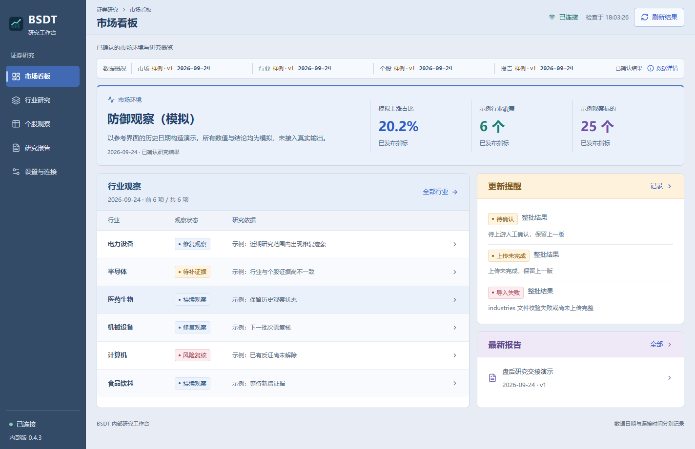
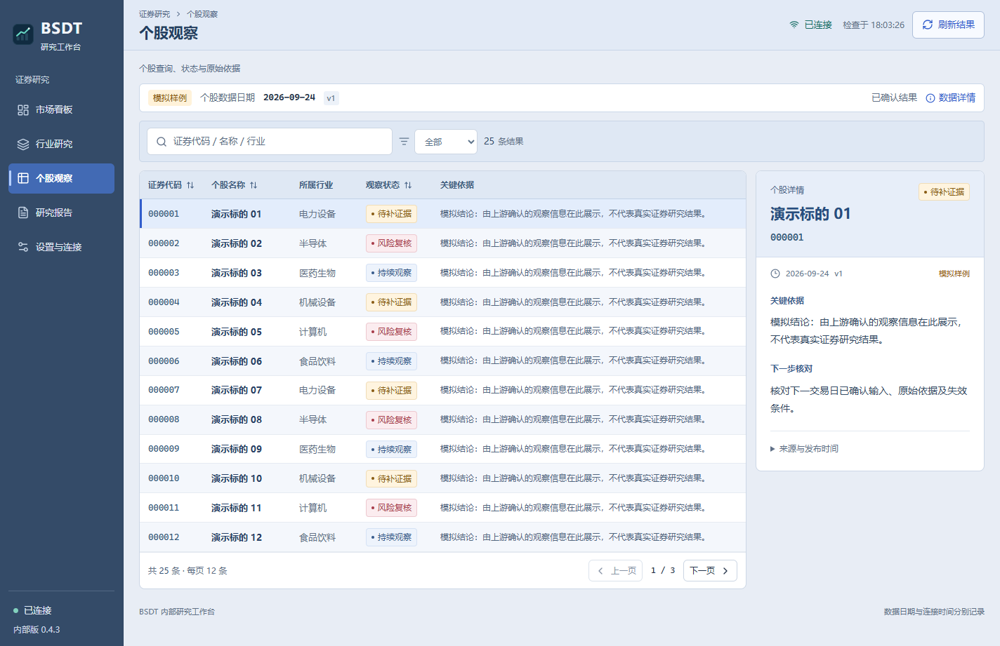
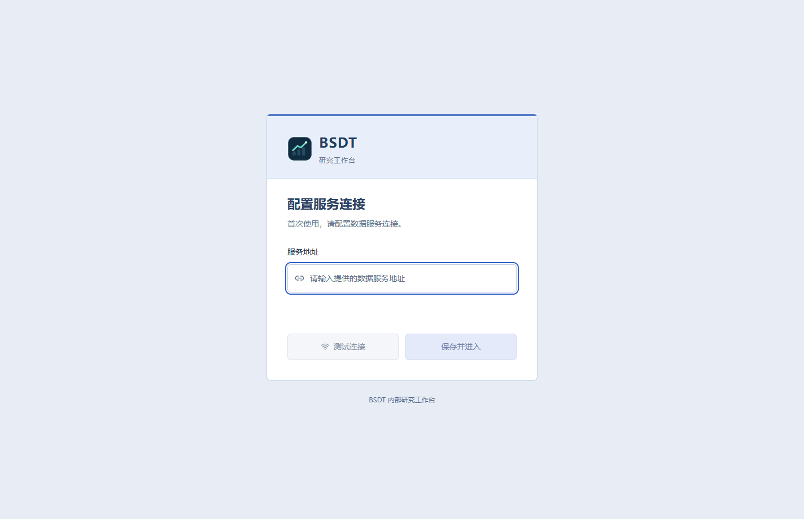
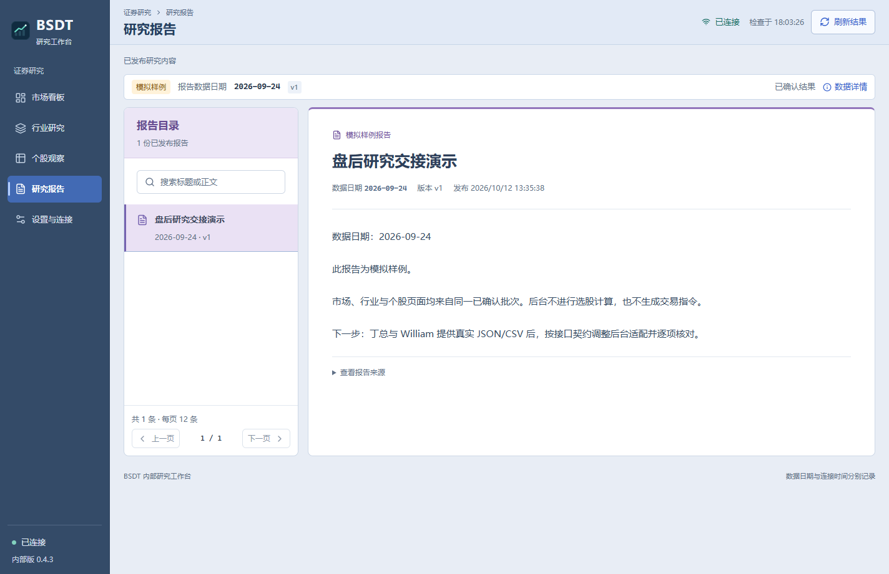
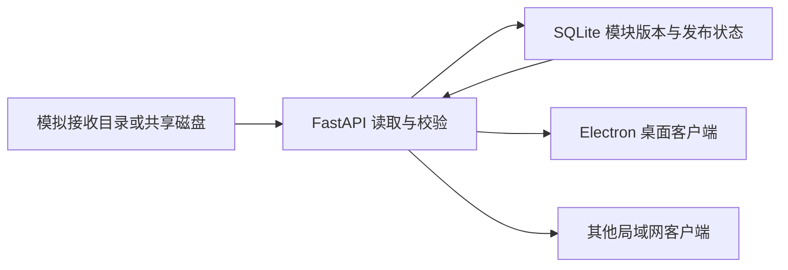

# BSDT 证券研究结果工作台

面向内部研究协作的 Windows 桌面应用。将市场、行业、个股及报告结果通过统一后台集中读取、确认发布和展示。

**当前版本：0.4.3。已完成可安装演示版与本机部署验证；数据为明确标识的历史／模拟结果。真实上游结果接入、跨电脑局域网联调和三人使用验收尚未完成。**

## 已实现

- 市场概览、行业研究、个股列表与详情、报告阅读、首次服务连接及设置页面。
- JSON／CSV 结果导入；各模块独立保存数据日期、版本与确认状态。
- 完整性、确认和校验通过后发布；待确认、上传不完整或失败时保留已发布版本。
- 后台分页、筛选、排序、详情按需读取与 ETag 版本校验。
- 启动刷新、定期检查、本地缓存、断线提示与恢复。
- Windows 安装包、稳定桌面图标、首帧准备后显示及单实例启动。

当前不包含选股算法、实时行情、K线、自动交易或客户订阅系统。上游分析策略及第三方行业模块不在本仓库中。

## 界面

| 市场概览 | 个股研究 |
| --- | --- |
|  |  |

| 首次连接 | 报告阅读 |
| --- | --- |
|  |  |

## 架构与运行方式

React + TypeScript + Vite 构建页面，Electron 提供 Windows 桌面外壳，FastAPI 提供统一数据接口，SQLite 保存结果与模块版本。



后台主机读取接收目录，客户端仅访问后台 HTTP 接口。共享磁盘路径与客户端服务地址分别配置。

## 新环境运行

环境：Windows x64、Python 3.12+、Node.js 22.12+、pnpm。

```powershell
python -m venv .venv
.\.venv\Scripts\python.exe -m pip install -r backend\requirements-lock.txt
pnpm install --frozen-lockfile
pnpm build
```

启动后台：

```powershell
powershell -NoProfile -ExecutionPolicy Bypass -File scripts\start-backend.ps1
```

启动源码版桌面：

```powershell
pnpm desktop
```

首次打开后填写服务地址并保存。本机可使用 `http://127.0.0.1:8765`；其他设备使用后台主机的局域网 IPv4 地址与端口。后台主机须保持运行，实际跨设备连通性需要现场验证。

开发页面：`pnpm dev`。后台健康检查：`http://127.0.0.1:8765/api/health`。关闭桌面不会停止后台；停止后台使用 `停止后台.cmd`。

## 打包与安装

```powershell
pnpm build
pnpm exec electron-builder --win nsis --x64
```

安装包生成到 `outputs/installers`。已安装客户端无需 Node.js 或 Python；运行后台的主机需要 Python 环境。安装包未进行代码签名。安装包不纳入 Git 源码历史；具备发布条件后通过私有 Releases 保存。

## 样例更新

默认后台只读取仓库中的 `test-upload` 模拟数据。四组初始样例分别覆盖已发布、待确认、上传不完整与导入失败。

```powershell
.\.venv\Scripts\python.exe scripts\demo_upload.py --batch demo-example-002 --date 2026-09-28 --csv
```

使用新的批次编号避免覆盖已有样例。模块独立上传格式、revision 和确认发布规则见 [上传契约](docs/上传契约.md)。后台默认每15秒检查目录变化；客户端按配置周期检查版本。

接入共享目录前先核对上游输出协议；配置方式见 [局域网联调清单](docs/局域网联调清单.md)。不得将模拟数据日期视为当前交易日或实时行情。

## 验证与已知边界

```powershell
.\.venv\Scripts\python.exe -m pytest backend -q
pnpm test
```

已有验证包括后台单元测试、前端数据测试、首次连接、分页排序、代码升降序、结果更新、离线缓存、启动显示与本机安装流程。近期交付证据见 [验证记录](docs/验证记录.md) 和 [验证摘要](docs/evidence/latest-validation.json)。这不代表跨电脑网络测试已完成。

`scripts/artifacts` 中的截图与任务表辅助脚本保留原开发用途，部分依赖额外的 Playwright 或原开发环境文档工具；不属于应用运行依赖。

## 仓库范围

本仓库仅整理桌面应用源码、人工构造的模拟样例、开发说明和精选截图。公司原始文档、第三方行业仓库、实际接收数据、SQLite、运行日志、密钥、依赖目录及构建缓存未纳入。

项目原始资料和唯一任务进度表继续保存在原工作目录的 `file` 中，本仓库不创建或维护任务表副本。开发验证记录保留真实完成情况；未完成项不包装为已上线成果。